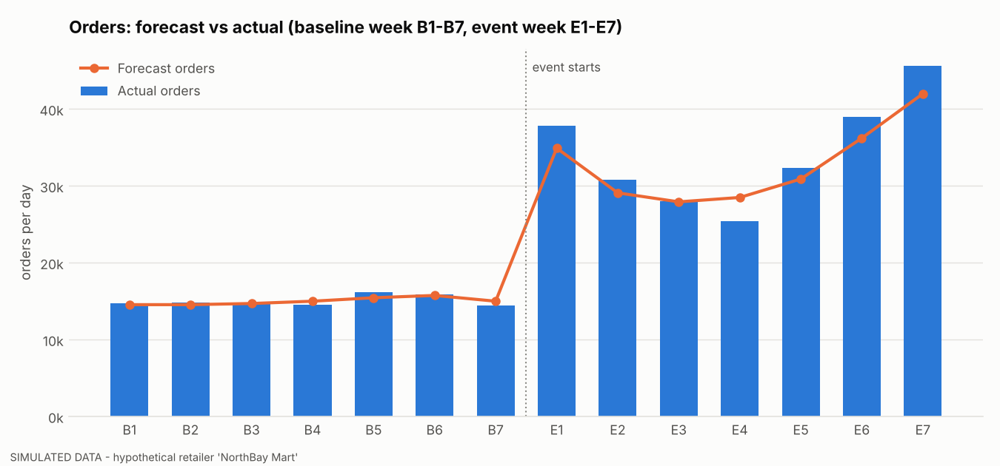
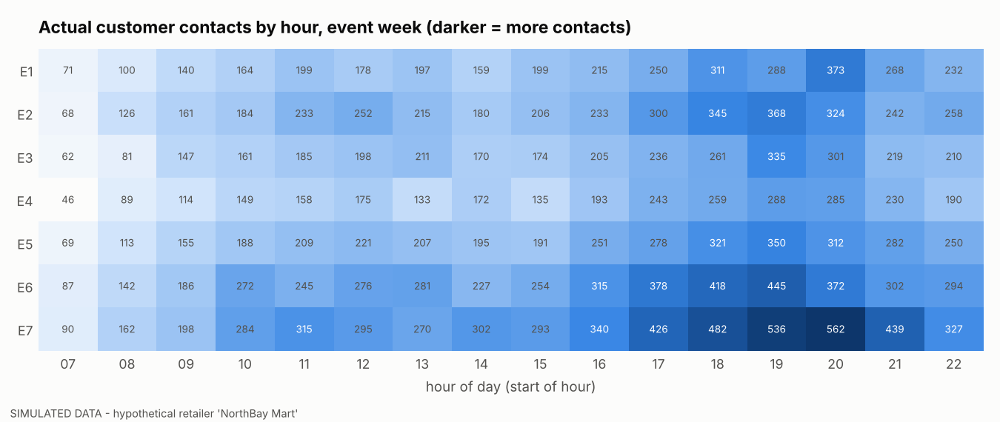
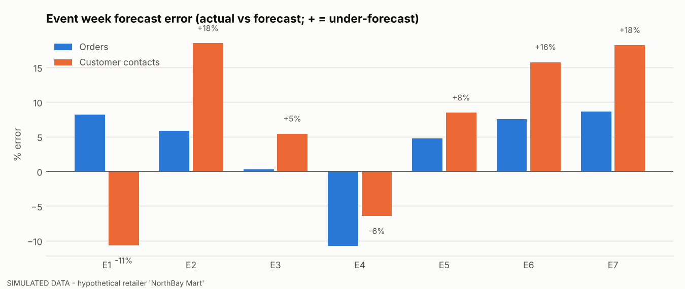
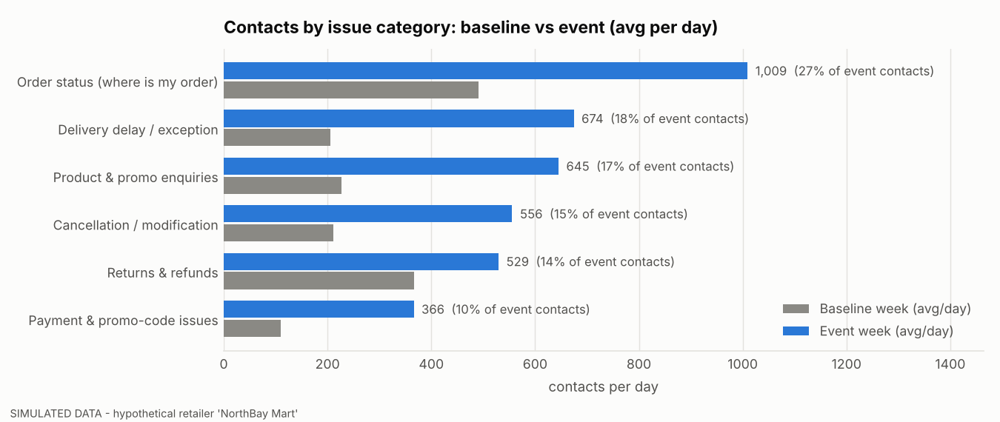
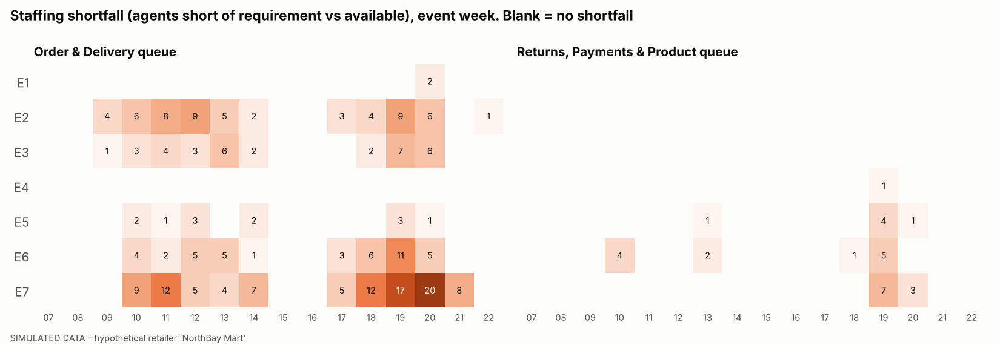
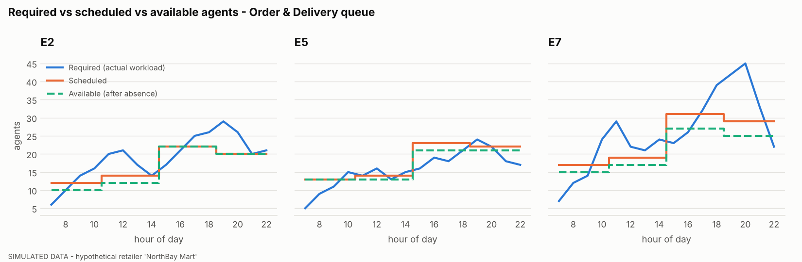
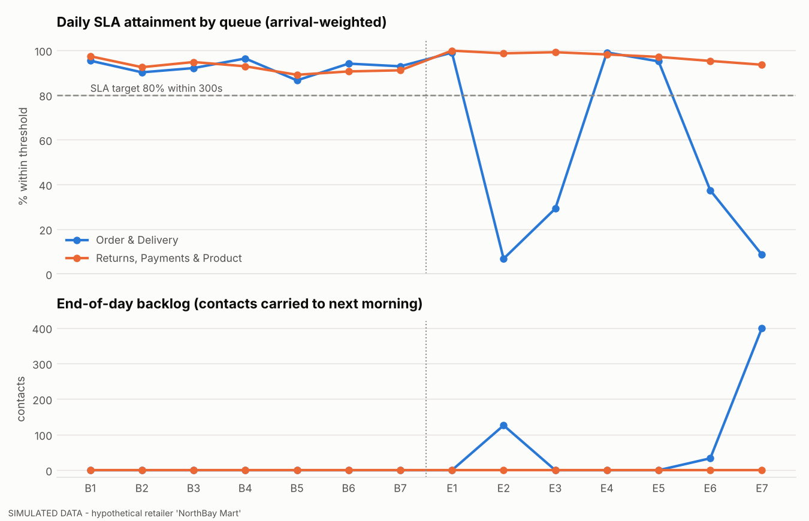
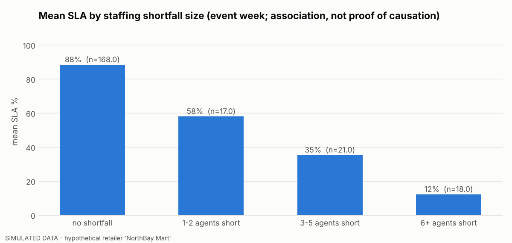
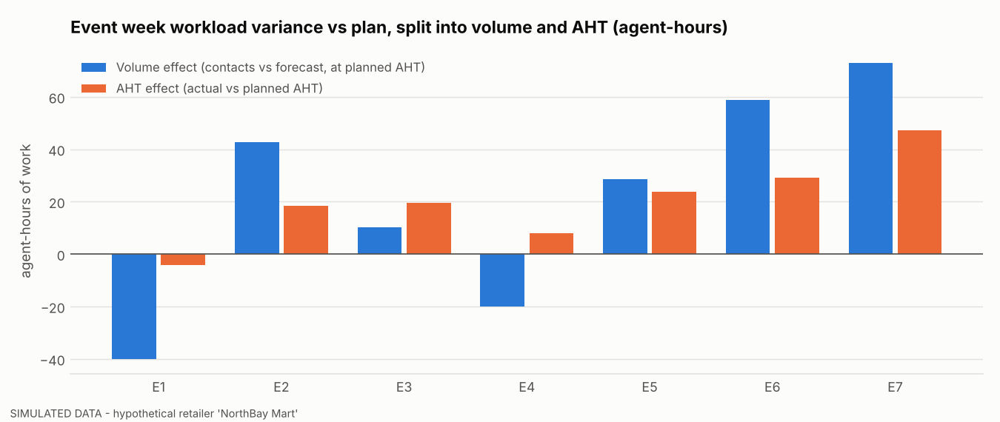
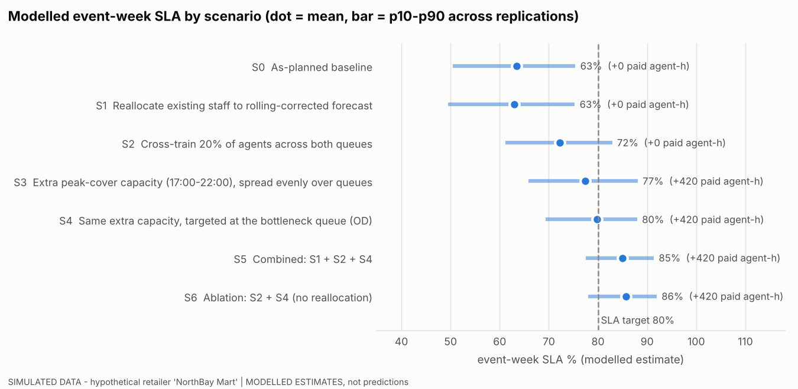

# 03 - Operational Analysis

> **SIMULATED DATA / HYPOTHETICAL BUSINESS.** This is an independent portfolio case study about a fictional retailer ("NorthBay Mart"). It uses no Amazon data, metrics or processes, and makes no claim about any real operation. Scenario results are *modelled estimates*, not measured improvements.

All numbers below are produced by `python -m src.run_pipeline` (seed 42) and read from `analysis/*.csv`. Charts are in `analysis/charts/`.

## A. E-commerce demand

**Orders.** Event orders total 238,980 over 7 days against a baseline-week average of 15,027 orders/day. The peak is E7 at 45,609 orders (3.0x baseline). Launch (E1) and finale (E7) are the order peaks; E4 is the trough (see table).

| Day | Forecast orders | Actual orders | Order error % | Forecast contacts | Actual contacts | Contact error % | Contacts / 100 orders | Peak hour |
|---|---|---|---|---|---|---|---|---|
| E1 | 34,920 | 37,791 | +8.2 | 3,743 | 3,344 | -10.7 | 8.8 | 20:00 |
| E2 | 29,100 | 30,812 | +5.9 | 3,119 | 3,695 | +18.5 | 12.0 | 19:00 |
| E3 | 27,930 | 28,020 | +0.3 | 2,994 | 3,156 | +5.4 | 11.3 | 19:00 |
| E4 | 28,500 | 25,444 | -10.7 | 3,055 | 2,859 | -6.4 | 11.2 | 19:00 |
| E5 | 30,900 | 32,363 | +4.7 | 3,312 | 3,592 | +8.4 | 11.1 | 19:00 |
| E6 | 36,225 | 38,941 | +7.5 | 3,883 | 4,494 | +15.7 | 11.5 | 19:00 |
| E7 | 42,000 | 45,609 | +8.6 | 4,502 | 5,321 | +18.2 | 11.7 | 20:00 |

(Error % = (actual - forecast) / forecast; positive = under-forecast.)

**Peak hours.** The single busiest hour is E7 20:00 with 562 contacts, +38% against forecast. Contacts concentrate in the evening (18:00-21:00) and the evening hour error on deal-drop days drives the intraday miss (20:00-21:59 contacts +14% vs forecast across the event week).

**Forecast accuracy.** Chosen metric: **WAPE** (sum of absolute errors / sum of actuals), reported with **bias**. WAPE is volume-weighted and stays stable at low-volume hours where MAPE explodes (see `A2_forecast_accuracy.csv` for both). Event-week orders WAPE is 6.5%. Event-week daily-total contacts WAPE is 11.5% with bias -7.0%.

The daily total looks tolerable but hides larger, offsetting category errors:

| Category (event week) | Actual | Forecast | WAPE % | Bias % |
|---|---|---|---|---|
| order_status | 7,066 | 7,492 | 9.9 | +6.0 |
| delivery_delay | 4,721 | 3,136 | 44.8 | -33.6 |
| cancel_modify | 3,890 | 3,230 | 22.4 | -17.0 |
| returns_refunds | 3,706 | 5,613 | 51.5 | +51.5 |
| payment_promo | 2,563 | 1,674 | 34.7 | -34.7 |
| product_enquiry | 4,515 | 3,462 | 23.3 | -23.3 |

Returns are *over*-forecast because the forecast applies a same-day contact rate while returns arrive 3-9 days after the order; delivery-delay, payment/promo and product contacts are *under*-forecast because they rise with exceptions, promo codes and event complexity that the baseline-week rates do not contain. Baseline-week accuracy is in-sample (rates learned from that week), so only the event week is a fair test.

**Contact drivers.** Order status is the largest category, but delivery delay, payment/promo and cancel/modify grew fastest.

| Issue category | Baseline avg/day | Event avg/day | Uplift % | Share of event contacts % | Cumulative % |
|---|---|---|---|---|---|
| Order status (where is my order) | 490 | 1,009 | +106 | 26.7 | 26.7 |
| Delivery delay / exception | 205 | 674 | +228 | 17.8 | 44.5 |
| Product & promo enquiries | 227 | 645 | +185 | 17.1 | 61.6 |
| Cancellation / modification | 211 | 556 | +163 | 14.7 | 76.3 |
| Returns & refunds | 367 | 529 | +44 | 14.0 | 90.3 |
| Payment & promo-code issues | 110 | 366 | +234 | 9.7 | 100.0 |

## B. Workforce capacity

**Method.** Required agents per queue-hour = workload hours x (1 + 10% buffer) / ((1 - planned shrinkage 0.173) x occupancy 0.85), rounded up. Rosters are built from the *forecast* requirement using three 8-hour shift templates (07-15, 11-19, 15-23). *Available* = scheduled minus simulated absences. Gap = actual present-basis requirement - available.

| Queue | Required (actual) agent-h | Available agent-h | Understaffed hours (of 112) | Shortfall agent-h (gross) | Surplus agent-h (gross) |
|---|---|---|---|---|---|
| OD | 1,947 | 1,952 | 46 | 246 | 251 |
| RP | 1,765 | 2,280 | 10 | 29 | 544 |

**What the numbers say.**

- **The weekly total hides the problem.** OD had 1,952 available vs 1,947 required agent-hours (net +5), yet it was short in 46 of 112 hours (246 gross agent-hours short), because surplus on calm days and hours cannot be banked for E2, E3, E6 and E7 evenings. Most shortfall sits at 19:00, 20:00, 11:00.
- **The surplus sits in the wrong queue.** RP had 2,280 available vs 1,765 required (+515 net) because the contact-mix forecast over-called returns and under-called order/delivery workload.
- **Workload variance decomposition** (event week, both queues): actual workload is +296 agent-hours vs forecast, of which volume explains +153 and AHT +142 (exact identity, tested). The queue-level AHT effect includes both the modelled complexity factor and the shift toward longer-handling categories within a queue; the two are not separated.

**Limitations of simplified staffing calculations.** (1) Workload/occupancy maths assumes a stable, steady-state hour; it ignores arrival burstiness within the hour, abandonment and skill-based routing. (2) Shrinkage and occupancy are single constants. (3) Integer rounding per hour inflates requirements at small volumes. (4) Shortfall is measured against the *planner's* occupancy target, not a hard limit. See `09_Methodology_and_Limitations.md`.

## C. Service levels

| Day | OD SLA % | RP SLA % | OD end backlog | OD hours below target |
|---|---|---|---|---|
| E1 | 99.0 | 99.9 | 0 | 0 |
| E2 | 6.8 | 98.7 | 126 | 14 |
| E3 | 29.2 | 99.2 | 0 | 14 |
| E4 | 99.1 | 98.2 | 0 | 0 |
| E5 | 95.1 | 97.1 | 0 | 2 |
| E6 | 37.4 | 95.3 | 33 | 10 |
| E7 | 8.6 | 93.6 | 400 | 14 |

**Staffing gaps and service deterioration.** Hours with a shortfall have far worse service than hours without:

| Shortfall size | Group-hours | Mean SLA % | Hours below target % | Mean response (s) | Mean end backlog |
|---|---|---|---|---|---|
| no shortfall | 168 | 88.4 | 9 | 261 | 7 |
| 1-2 agents short | 17 | 58.0 | 59 | 920 | 30 |
| 3-5 agents short | 21 | 35.3 | 76 | 1,241 | 57 |
| 6+ agents short | 18 | 12.2 | 94 | 2,657 | 146 |

9 of the 11 below-target SLA episodes (contiguous below-target hours, `C5_sla_breach_episodes.csv`) began in, or within two hours after, an understaffed hour.

**Correlation is not proven causation.** Spearman rank correlation between shortfall and same-hour SLA is -0.81; between load ratio and SLA -0.78; demand alone vs SLA -0.44. Two cautions:

1. *Confounding:* shortfalls cluster in high-demand hours, so demand and shortfall move together. The stratified view below compares hours of similar workload with and without a shortfall.
2. *By construction:* SLA here is **generated** by a queue model from staffing and load, so the relationship is built in. In real data you would need a design (e.g. before/after a roster change, or comparison across comparable queues) to argue causation. The scenario runs (section E) are the closest this project gets: same demand, same absences, only staffing changed.

| Workload tercile / shortfall flag | Group-hours | Mean SLA % | Hours below target % |
|---|---|---|---|
| low load / not short | 72 | 96.9 | 4 |
| low load / short | 3 | 0.0 | 100 |
| mid load / not short | 59 | 91.6 | 8 |
| mid load / short | 15 | 34.0 | 80 |
| high load / not short | 37 | 77.6 | 19 |
| high load / short | 38 | 31.8 | 74 |

(Metric assumptions: SLA = share of contacts answered within 300s, arrival-weighted; response time = Erlang-C ASA or fluid-queue mean wait; backlog carries overnight. See `02_KPI_Dictionary.md`.)

## D. Variance and risk

Largest planned-vs-actual variances in the event week (planned = forecast, plan or SLA target; backlog excluded because its plan is zero):

| # | Day | Metric | Planned | Actual | Variance % |
|---|---|---|---|---|---|
| 1 | E7 | Fulfilment exceptions | 1,010.2 | 6,911.0 | +584 |
| 2 | E6 | Fulfilment exceptions | 871.3 | 2,674.0 | +207 |
| 3 | E1 | Fulfilment exceptions | 839.9 | 1,965.0 | +134 |
| 4 | E5 | Fulfilment exceptions | 743.2 | 1,685.0 | +127 |
| 5 | E4 | Fulfilment exceptions | 685.5 | 1,362.0 | +99 |
| 6 | E1 | Cancellations | 875.8 | 1,414.0 | +61 |
| 7 | E2 | Cancellations | 729.8 | 1,127.0 | +54 |
| 8 | E2 | SLA attainment | 80.0 | 37.6 | -53 |
| 9 | E7 | SLA attainment | 80.0 | 42.5 | -47 |
| 10 | E3 | SLA attainment | 80.0 | 56.3 | -30 |

Fulfilment exceptions dominate the list: orders exceeded the 36,000/day fulfilment capacity on E1, E6, E7, and the carrier disruption added exceptions on E4-E5. Those exceptions feed delivery-delay contacts one to two days later, which is why the service collapse follows the exceptions rather than coinciding with them (E1 launch day held SLA; E2 did not).

**Risk register.** 12 risks, ranked by probability x impact, are in `04_Risk_and_Mitigation_Register.csv`, with owner, mitigation, linked scenario, dependencies, due date and escalation trigger. Cross-team dependencies between Operations, Workforce Planning and Customer Support are in `04b_Dependency_Tracker.csv`.

## E. Mitigation scenarios (MODELLED ESTIMATES)

Single-seed and 200-replication Monte Carlo results are in `E1_...csv`, `E2_...csv`, `E3_...csv`. Mean and p10-p90 are across replications that each re-draw orders, contacts, handling times and absences; scenarios within a replication share the same demand and absence draws, so differences are paired.

| ID | Scenario | Mean event SLA % | p10 | p90 | OD SLA % | Paired change vs S0 (pp) | End backlog | Days meeting target (of 7) | Extra paid agent-h |
|---|---|---|---|---|---|---|---|---|---|
| S0 | As-planned baseline | 63.5 | 50.5 | 75.4 | 45.5 | +0.0 | 174 | 2.2 | 0 |
| S1 | Reallocate existing staff to rolling-corrected forecast | 63.0 | 49.5 | 75.3 | 44.8 | -0.5 | 163 | 2.2 | 0 |
| S2 | Cross-train 20% of agents across both queues | 72.2 | 61.2 | 82.9 | 61.0 | +8.7 | 113 | 3.3 | 0 |
| S3 | Extra peak-cover capacity (17:00-22:00), spread evenly over queues | 77.4 | 65.8 | 88.1 | 65.1 | +14.0 | 48 | 4.2 | 420 |
| S4 | Same extra capacity, targeted at the bottleneck queue (OD) | 79.8 | 69.4 | 88.0 | 73.1 | +16.3 | 15 | 4.2 | 420 |
| S5 | Combined: S1 + S2 + S4 | 84.9 | 77.5 | 91.4 | 80.6 | +21.4 | 4 | 4.9 | 420 |
| S6 | Ablation: S2 + S4 (no reallocation) | 85.7 | 78.0 | 91.9 | 81.8 | +22.2 | 4 | 5.1 | 420 |

**Reading the scenarios (all modelled; none is a measured gain):**

- **S1 reallocation** (same headcount, re-shaped across the three shift templates using a rolling-corrected forecast): paired change -0.5 pp, better than S0 in 22% and worse in 46% of replications (by more than 0.5 pp). With so few shift shapes and a fixed headcount, the surplus is in the *other queue* and *other days*, which this lever cannot reach.
- **S2 cross-training** (20% of agents, 10% slower on the other queue): +8.7 pp at no extra paid hours. Training time and cost are **not** modelled, so this overstates net benefit.
- **S3 / S4 extra peak-cover capacity** (+420 paid agent-hours; evenly split vs all to OD): +14.0 pp vs +16.3 pp. Same cost, targeting the bottleneck queue is worth about 2.3 pp more; the p10-p90 ranges overlap, so treat the difference as indicative.
- **S5 vs S6** isolate S1 inside the combined option: 84.9% vs 85.7% mean SLA, so reallocation adds nothing measurable on top of cross-training and targeted capacity.
- Single-seed results (`E1_scenario_comparison_single_seed.csv`) are one draw of the same model and differ from the Monte Carlo means; prefer the Monte Carlo view.
